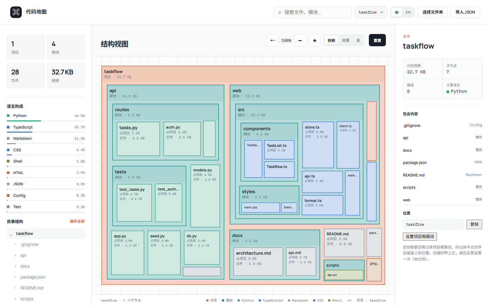

# Code Atlas

把代码仓库变成一张可以浏览的地图。

每个方块代表一个文件或目录，面积表示文件大小，颜色区分语言。选中文件，还可以查看引用关系和共享字符串等线索。



## 开始使用

打开 [在线版](https://BEIDAKULEWUWUWU.github.io/code-atlas/viewer/index.html)，拖入项目文件夹，或点击「选择文件夹」。扫描在浏览器本地完成，不上传文件。

也可以在本地运行（需要 Node.js 22+）：

```bash
npm start
```

访问 [localhost:8123/viewer/index.html](http://localhost:8123/viewer/index.html)。无需安装依赖或构建。

## 浏览项目

- 点击目录进入下一层，通过目录树切换位置。
- 使用搜索框查找文件，滚轮缩放地图。
- 选中节点，在右侧查看大小、路径和文件关系。
- 设置项目根路径后，双击文件可交给编辑器打开。

关系通过轻量规则识别，适合作为阅读代码的线索，可能存在遗漏或误判。

## 命令行扫描

较大的项目可以先扫描为 JSON，再通过页面的「导入 JSON」打开：

```bash
node tools/scan.js ../my-project --out my-project.json
```

分享扫描结果时，可加上 `--no-root-path`，避免包含本机路径。更多选项见：

```bash
node tools/scan.js --help
```

## 开发

查看器位于 `viewer/`，扫描器位于 `tools/scan.js`，示例项目位于 `samples/` 和 `sample-project/`。

运行检查：

```bash
npm run check
```

## 许可

[MIT](LICENSE)
